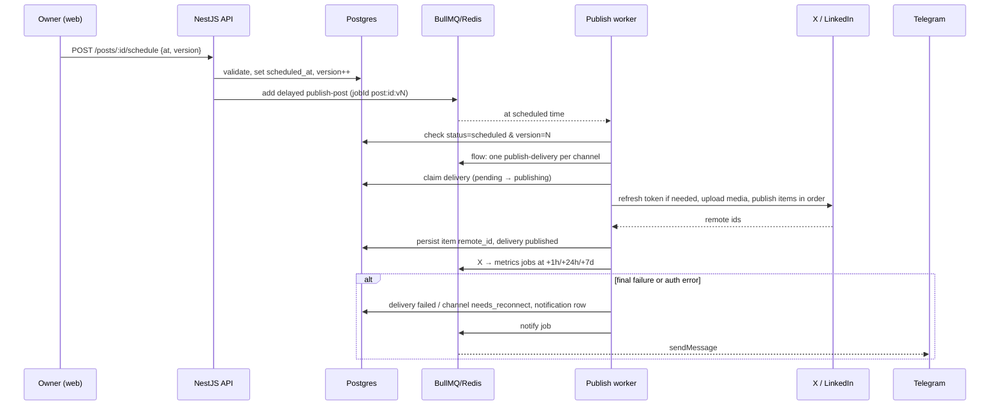

# Technical Spec: Core Publishing

## Metadata
- **Date:** 2026-10-28
- **Branch:** mvp/core-publishing
- **Based on:** functional-spec.md
- **Status:** WIP

## Architecture and patterns

### Decision: modular monolith (NestJS) + one adapter per social network
The API is a single NestJS application split into domain modules:
- `auth`
- `channels`
- `providers`
- `posts`
- `scheduling`
- `media`
- `notifications`
- `metrics`
- `settings`
- `health`

Every social network is implemented as an adapter behind a common `SocialProvider` interface. Adding Instagram, Facebook or Bluesky later means adding one adapter without touching the domain modules.

```ts
interface SocialProvider {
  id: 'x' | 'linkedin';
  limits: ProviderLimits;                       // chars, images per item, max bytes, mime types, thread support
  getAuthorizationUrl(state: string, pkce: Pkce): URL;
  exchangeCode(code: string, pkce: Pkce): Promise<TokenSet>;
  refresh(tokens: TokenSet): Promise<TokenSet>; // throws ReauthRequired when impossible
  getProfile(tokens: TokenSet): Promise<ChannelProfile>;
  uploadMedia(tokens: TokenSet, file: MediaFile): Promise<RemoteMediaRef>;
  publishItem(tokens: TokenSet, item: PublishItem, replyTo?: RemoteRef): Promise<RemoteRef>;
  fetchMetrics?(tokens: TokenSet, refs: RemoteRef[]): Promise<MetricsSnapshot[]>;
  classifyError(err: unknown): 'retryable' | 'auth' | 'permanent';
}
```

**Why:**
- A single user and a 1 vCPU VPS do not justify microservices.
- Modules keep boundaries clear for open-source contributors.
- Adapters isolate each network's quirks (OAuth details, media upload, error codes).

**Discarded alternatives:**
- Full hexagonal: too much ceremony for this domain size.
- Classic layered: network-specific logic ends up mixed into services.

### Runtime topology
```
             Tailscale (HTTPS on *.ts.net, nothing public)
                              │
                       ┌──────▼──────┐
                       │  web (Next) │  /*        (UI)
                       │             │  /api/* ──► rewrite to api:4000 (same origin → first-party cookie)
                       └──────┬──────┘
                       ┌──────▼──────────────────────────┐
                       │ api (NestJS)                    │
                       │  HTTP controllers               │
                       │  BullMQ workers (same process)  │
                       └───┬───────────────────┬─────────┘
                    ┌──────▼─────┐       ┌─────▼─────┐      ┌───────────────┐
                    │ PostgreSQL │       │  Redis 8  │      │ media volume  │
                    │ (truth)    │       │ (BullMQ)  │      │ (local disk)  │
                    └────────────┘       └───────────┘      └───────────────┘
```

- **Workers in the API process:** they are toggled with `WORKERS_ENABLED=true`, so they can be split into their own container later without code changes.
- **Same-origin setup:** the web rewrites `/api/*` to the API, so the session cookie is first-party and no CORS setup is needed.

### Monorepo layout (pnpm workspaces + Turborepo)
```
apps/
  api/                 NestJS
  web/                 Next.js (App Router, standalone output)
packages/
  shared/              zod schemas, provider limits, X weighted-length counter, thread splitter, constants
  api-client/          generated from OpenAPI (orval → typed fetch + TanStack Query hooks)
  config/              tsconfig, eslint, prettier presets
infra/
  docker-compose.yml   postgres, redis, api, web
  docker-compose.dev.yml
  .env.example
  tailscale/README.md  how to expose with `tailscale serve`
AiBuild/               SDD cycles
```

`packages/shared` holds the logic that must behave the same in the composer and in API validation: per-network limits, X weighted character counting, and the thread splitter.

## Data model (PostgreSQL + Drizzle)
All timestamps are `timestamptz` stored in UTC. IDs are UUIDv7, which are time-sortable.

### New entities
**users** — single owner, but modelled as a table for future multi-user.
- `id`
- `username` (unique)
- `password_hash` (argon2id)
- `created_at`, `updated_at`

**sessions**
- `id`: sha256 of a random 256-bit token; only the hash is stored.
- `user_id` → users
- `expires_at`, `last_seen_at`
- `user_agent`, `ip`
- `created_at`

**channels**
- `id`
- `provider` enum(`x`, `linkedin`)
- `external_id`, `handle`, `display_name`, `avatar_url`
- `status` enum(`connected`, `needs_reconnect`, `disconnected`)
- `access_token_enc`, `refresh_token_enc` (AES-256-GCM)
- `token_expires_at`, `refresh_expires_at`
- `scopes` text[]
- `settings` jsonb (`{ longPostsEnabled: boolean }`)
- `created_at`, `updated_at`
- unique(`provider`, `external_id`)

**posts**
- `id`
- `base_content` text
- `status` enum(`draft`, `scheduled`, `publishing`, `published`, `partially_published`, `failed`, `missed`)
- `scheduled_at` (nullable)
- `scheduled_via` enum(`manual`, `queue`, `now`) (nullable)
- `published_at`
- `created_at`, `updated_at`
- `version` int: optimistic locking and the job staleness guard.

**deliveries** — one row per post × channel.
- `id`
- `post_id` → posts (cascade)
- `channel_id` → channels
- `customized` boolean: false means items are regenerated from `base_content`.
- `status` enum(`pending`, `publishing`, `published`, `failed`, `missed`)
- `last_error_code`, `last_error_message`
- `needs_attention` boolean (channel disconnected, etc.)
- `published_at`

**delivery_items** — a single post is one item; an X thread is N items.
- `id`
- `delivery_id` → deliveries (cascade)
- `position` int
- `text`
- `status` enum(`pending`, `published`, `failed`)
- `remote_id`, `remote_url`
- `published_at`
- unique(`delivery_id`, `position`)

**delivery_item_media**
- `delivery_item_id`, `media_id`, `position`

**media**
- `id`
- `storage_key`, `mime`, `bytes`, `width`, `height`
- `sha256` (dedupe)
- `created_at`

**delivery_attempts** — audit trail.
- `id`
- `delivery_id`
- `attempt`
- `started_at`, `finished_at`
- `outcome` enum(`success`, `retryable_error`, `auth_error`, `permanent_error`, `interrupted`)
- `error_code`, `error_message`

**queue_slots**
- `id`
- `weekday` smallint (0–6)
- `local_time` time
- `enabled` boolean

**settings** — key/value.
- `key` text PK
- `value` jsonb
- Keys: `timezone`, `missedGraceMinutes` (default 360).

**notifications**
- `id`
- `type` (`delivery_failed`, `channel_reauth`, `token_expiring`, `post_missed`)
- `severity`
- `title`, `body`, `link`
- `read_at`, `created_at`

**post_metrics**
- `id`
- `delivery_item_id`
- `checkpoint` enum(`1h`, `24h`, `7d`, `manual`)
- `fetched_at`
- `impressions`, `likes`, `reposts`, `replies`, `quotes`, `bookmarks`
- `raw` jsonb

### Indexes
- `posts(status, scheduled_at)` — calendar range queries and the reconciler.
- `posts(scheduled_at)` — calendar range.
- `deliveries(post_id)`, `deliveries(channel_id, status)`.
- `delivery_items(delivery_id, position)`.
- `post_metrics(delivery_item_id, fetched_at desc)`.
- `notifications(read_at, created_at desc)`.

### Migrations
- Drizzle Kit generates SQL migrations under `apps/api/drizzle/`.
- The API runs pending migrations on start behind a Postgres advisory lock.

## Scheduling design (BullMQ + Redis 8)
**Postgres is the source of truth; BullMQ only executes.** Every job re-reads the database before acting.

### Queues
| Queue | Job | Notes |
|---|---|---|
| `publish` | `publish-post` (parent) | Delayed until `scheduled_at`. `jobId = post:{id}:v{version}`. Spawns one child per delivery (BullMQ Flow). |
| `publish` | `publish-delivery` (child) | `attempts: 3`, exponential backoff, base 2 min (≈2 + 4 + 8 min ≈ 14 min). Auth and permanent errors throw `UnrecoverableError` (no retry). Concurrency 2. |
| `metrics` | `fetch-metrics` | Delayed +1 h, +24 h, +7 d after an X delivery is published. `jobId = metrics:{itemId}:{checkpoint}`. |
| `maintenance` | `reconcile` | Repeatable every 5 min, and also run on boot. |
| `maintenance` | `token-expiry-check` | Repeatable daily. |
| `notify` | `telegram` | `attempts: 5`, so a Telegram outage never blocks publishing. |

### Key behaviours
**Schedule or reschedule:**
1. Bump `posts.version` and remove the previous delayed job.
2. Add a new job with the new `jobId`.
3. A stale job (version mismatch or status not `scheduled`) exits as a no-op.

**Double-publish guard:** the delivery job claims work with a conditional update:
```sql
UPDATE deliveries SET status = 'publishing'
WHERE id = $1 AND status IN ('pending', 'failed')
RETURNING *
```
If no row comes back, the job exits.

**Threads:**
- Items are published sequentially, each replying to the previous item's `remote_id`.
- Each item's `remote_id` is persisted right after it succeeds.
- A retry, automatic or manual, resumes from the first unpublished item. This gives "Retry from failed item" for free.

**Post status:** derived from its deliveries after each delivery finishes.

**Reconciler:**
- `scheduled` posts with no pending job are re-enqueued, for example after Redis data loss.
- Overdue posts:
  - overdue by less than `missedGraceMinutes` → published now;
  - older → marked `missed` and notified.
- Deliveries stuck in `publishing` for more than 20 min are marked `failed` with outcome `interrupted`, and the owner is told to verify on the network. They are not auto-retried, because the post might already be live.

**Token refresh:**
- Before publishing, if the access token expires within 5 min, the adapter refreshes it.
- Refresh is serialized per channel with a Redis lock, because X rotates refresh tokens and two concurrent refreshes would invalidate one.
- On a `ReauthRequired` error the channel is set to `needs_reconnect` and the owner is notified.

**Redis configuration:**
- `maxmemory 128mb`
- `maxmemory-policy noeviction` (required by BullMQ)
- `appendonly yes` (AOF), so delayed jobs survive restarts.

## Provider adapters

### X (API v2, OAuth 2.0 Authorization Code + PKCE)
- **Scopes:** `tweet.read tweet.write users.read media.write offline.access`.
- **Endpoints:**
  - `POST /2/tweets` (with `reply.in_reply_to_tweet_id` for threads)
  - v2 media upload
  - `GET /2/users/me`
  - `GET /2/tweets?ids=…&tweet.fields=public_metrics` for metrics, batched per checkpoint
- **Text length:** X weighted length (URLs count as 23, some characters as 2), implemented in `packages/shared` with the `twitter-text` rules. 280 by default; the limit comes from `channel.settings.longPostsEnabled`.
- **Cost awareness:** the composer flags items that contain URLs. Metrics are only fetched at the three checkpoints plus manual refreshes.
- **Verify during build:** confirm the exact scopes, the media-upload endpoint and the metrics fields against the current X docs before implementing; they change often.

### LinkedIn (Share on LinkedIn + Sign In with LinkedIn using OpenID Connect)
- **Scopes:** `openid profile w_member_social`.
- **Endpoints:**
  - `GET /v2/userinfo` (the `sub` field gives the person URN)
  - `POST /rest/posts` with the `Linkedin-Version` header and author `urn:li:person:{id}`
  - Images API (`initializeUpload` + PUT) for images
- **Tokens:**
  - ~60-day access tokens.
  - Refresh tokens are used if LinkedIn returns them; otherwise the reconnect flow applies.
  - The daily `token-expiry-check` job warns 7 days before expiry.
- **Single post only:** LinkedIn has no threads, so a delivery always has 1 item.

### OAuth plumbing
- The `state` and PKCE verifier are stored in Redis with a 10 min TTL and bound to the session.
- **Redirect URI:** `${PUBLIC_BASE_URL}/api/v1/channels/{provider}/callback`. `PUBLIC_BASE_URL` is the `https://<host>.<tailnet>.ts.net` URL. Redirects run in the owner's browser, so the server never needs to be public.
- Providers without credentials in env are reported as `configured: false` by `GET /providers`.

## API / Contracts
**Conventions:**
- REST under `/api/v1`.
- JSON only, with dates as ISO 8601 UTC.
- Errors use RFC 9457 `application/problem+json` (`type`, `title`, `status`, `detail`, `code`, `errors[]`).
- OpenAPI is generated from zod schemas via `nestjs-zod`; `packages/api-client` is generated from it with orval.

### Auth
| Method | Route | Body / Notes |
|---|---|---|
| GET | `/auth/setup-status` | `{ needsSetup: boolean }` |
| POST | `/auth/setup` | `{ username, password }` → 201 + session cookie. 409 if an owner exists. |
| POST | `/auth/login` | `{ username, password }` → 204 + cookie. 401 on bad credentials, 429 when throttled. |
| POST | `/auth/logout` | 204 |
| GET | `/auth/me` | `{ id, username }` |

### Channels and providers
| Method | Route | Notes |
|---|---|---|
| GET | `/providers` | `[{ id, configured, limits }]` |
| GET | `/channels` | List with status and settings. |
| GET | `/channels/:provider/connect` | 302 to the provider consent screen. |
| GET | `/channels/:provider/callback` | Handles `code` + `state`, upserts the channel, then 302 to `/settings/channels?connected=…`. |
| PATCH | `/channels/:id` | `{ settings: { longPostsEnabled } }` |
| DELETE | `/channels/:id` | Disconnect: deletes tokens and flags pending deliveries. |

### Media
| Method | Route | Notes |
|---|---|---|
| POST | `/media` | multipart `file` → `{ id, mime, bytes, width, height, url }`. 413 if too large, 415 if unsupported. |
| GET | `/media/:id` | Streams the file; auth required. |

### Posts
| Method | Route | Notes |
|---|---|---|
| GET | `/posts?from&to&status` | Calendar range (max 62 days) → posts with deliveries summary. |
| POST | `/posts` | `PostInput` → draft. |
| GET | `/posts/:id` | Full post: deliveries, items, media, attempts, latest metrics. |
| PUT | `/posts/:id` | `PostInput`; only for `draft`/`scheduled`. 409 if `publishing` or later, or on version mismatch. |
| DELETE | `/posts/:id` | Only for `draft`/`scheduled`/`failed`/`missed`. |
| POST | `/posts/:id/schedule` | `{ at, version }`. 422 if in the past or validation fails. |
| POST | `/posts/:id/queue` | `{ version }` → `{ scheduledAt }`. 422 `NO_FREE_SLOT` if none within 30 days. |
| POST | `/posts/:id/publish-now` | `{ version }` |
| POST | `/posts/:id/unschedule` | Back to draft. |
| POST | `/deliveries/:id/retry` | Resumes from the first unpublished item. |
| POST | `/posts/:id/metrics/refresh` | Manual X metrics fetch (rate limited: 1 per 15 min per post). |

`PostInput`:
```ts
{
  version?: number;
  baseContent: string;
  baseMediaIds: string[];
  channels: Array<{
    channelId: string;
    customized: boolean;
    items?: Array<{ text: string; mediaIds: string[] }>; // required when customized
  }>;
}
```
Validation runs per provider using the shared limits, and errors point to `channels[i].items[j]`.

### Scheduling settings, notifications, health
| Method | Route | Notes |
|---|---|---|
| GET/PUT | `/settings` | `{ timezone, missedGraceMinutes }` |
| GET/PUT | `/queue-slots` | Replace the whole weekly set. |
| GET | `/queue-slots/next` | Preview of the next free slot. |
| GET | `/notifications?unread` | |
| POST | `/notifications/:id/read`, `/notifications/read-all` | |
| GET | `/health` | DB + Redis checks, unauthenticated, for Docker health checks. |
| GET | `/admin/queues` | Bull Board UI, behind the session guard. |

### Events / messages
- No external webhooks in this stage.
- Telegram is outbound only: `sendMessage` via the Bot API, with `TELEGRAM_BOT_TOKEN` and `TELEGRAM_CHAT_ID` from env.
- The web refreshes calendar and notifications with TanStack Query polling (30 s) while the tab is visible. SSE can come later.

## Web (Next.js)
**Stack:**
- App Router with a mostly client-side dashboard.
- Tailwind + shadcn/ui, with a custom theme: a colorful, Metricool-inspired palette with its own identity, in light and dark modes.

**i18n:** `next-intl`, Spanish by default, with English message catalogs scaffolded.

**Calendar:** FullCalendar (MIT core, daygrid, timegrid, interaction), with week/month views, drag & drop and click on an empty slot.

**Composer:**
- Plain textareas, no rich text, since networks take plain text.
- Live weighted counters from `packages/shared`.
- Thread editor (split, add, reorder) and per-channel tabs (Base / X / LinkedIn).
- Preview cards per network.
- Image drop zone.
- Forms with react-hook-form + zod.

**Data:** orval-generated TanStack Query hooks; dates handled with `date-fns` + `date-fns-tz`.

**Routes:**
- `/setup`, `/login`
- `/calendar` (default)
- `/posts/new`, `/posts/[id]`
- `/settings/channels`, `/settings/queue`, `/settings/general`
- `/notifications`

## Dependencies
| Package | Purpose | Alternative considered |
|---|---|---|
| pnpm + Turborepo | Workspaces and cached task runner | Nx (heavier) |
| NestJS + `@nestjs/bullmq` | API framework, queue integration | Fastify/Express by hand |
| bullmq | Delayed jobs, retries, flows, rate limiting | pg-boss (rejected by owner), Temporal (too heavy) |
| Redis 8 (Docker image) | BullMQ backend | Valkey (not in BullMQ's officially tested list) |
| drizzle-orm + drizzle-kit | Typed SQL, migrations | Prisma, MikroORM |
| pg (node-postgres) | Postgres driver | postgres.js |
| zod + nestjs-zod | Validation and OpenAPI generation | class-validator |
| orval | OpenAPI → typed client + TanStack Query hooks | openapi-typescript + openapi-fetch |
| argon2 | Password hashing | bcrypt |
| @nestjs/throttler (Redis storage) | Login and metrics rate limits | custom |
| sharp | Image normalization, EXIF/GPS stripping, resizing to network limits | jimp (slower) |
| file-type | Magic-byte MIME sniffing on upload | trusting the Content-Type header |
| twitter-text | X weighted length rules (shared) | own implementation |
| pino (nestjs-pino) | Structured JSON logs | winston |
| @bull-board/nestjs | Queue dashboard | none |
| Next.js, Tailwind, shadcn/ui | Web UI | Mantine, MUI |
| @fullcalendar/* (MIT parts only) | Calendar with drag & drop | react-big-calendar |
| next-intl | i18n | react-i18next |
| @tanstack/react-query | Server state | SWR |
| react-hook-form | Forms | Formik |
| date-fns, date-fns-tz | Timezone handling | luxon, dayjs |
| vitest, @testcontainers/postgresql, @testcontainers/redis, msw | Tests | jest, nock |
| gitleaks (pre-commit + CI) | Secret scanning | trufflehog |

Versions are pinned to the current stable releases when scaffolding and locked in `pnpm-lock.yaml`.

## Performance
**Memory budget on 1 vCPU / 4 GB:**
| Service | Target |
|---|---|
| Postgres (`shared_buffers=256MB`) | ~300 MB |
| Redis (`maxmemory 128mb`) | ~50 MB |
| API (`--max-old-space-size=512`) | ~250 MB |
| Web (Next standalone, `--max-old-space-size=384`) | ~200 MB |
| **Total** | **~0.8–1 GB**, leaving headroom for the OS, Tailscale and the later digest stage |

**Builds:** Docker images are built in GitHub Actions and pushed to GHCR. The VPS only pulls.

**Workers:**
- Publish concurrency is 2, and metrics concurrency is 1 with a rate limiter.
- The X metrics fetch batches all items due in the same checkpoint into one `GET /2/tweets?ids=` call (up to 100 ids).

**Queries:**
- The calendar range is capped at 62 days and served by the `(status, scheduled_at)` index.
- No N+1: deliveries are loaded with a single join per range.

**Images:**
- Uploads are normalized with sharp (EXIF stripped, resized and re-encoded only when above network limits).
- Files are stored once and deduplicated by sha256.

## Security
- **Authentication:**
  - argon2id passwords (minimum length 12).
  - Session token is 256-bit random; only its sha256 is stored.
  - Cookie: `HttpOnly`, `Secure`, `SameSite=Lax`, 30-day sliding expiry.
  - Logout deletes the session row.
- **CSRF:** `SameSite=Lax` plus a strict `Origin`/`Referer` check on every mutating request, compared against `PUBLIC_BASE_URL`.
- **Brute force:** throttler on `/auth/login` (5 attempts / 15 min per IP + username, Redis-backed).
- **Setup race:** `/auth/setup` runs in a transaction that checks no user exists.
- **Secrets at rest:**
  - OAuth tokens are encrypted with AES-256-GCM using `ENCRYPTION_KEY` (32 bytes, base64, from env).
  - Ciphertext carries a key-version prefix so the key can be rotated later.
- **OAuth:** PKCE + `state` bound to the session with a 10 min TTL; callbacks reject unknown or expired state.
- **Uploads:**
  - Max 15 MB.
  - Allowed: jpeg, png, webp, gif (static), verified by magic bytes.
  - Metadata stripped, stored under random keys, served only to authenticated sessions.
- **Headers:** helmet on the API; CSP, `X-Frame-Options` and `Referrer-Policy` set in Next.js.
- **Exposure:** no public ports. Docker publishes only on `127.0.0.1`, and Tailscale (`tailscale serve`) terminates HTTPS. Postgres and Redis are never published.
- **Validation:** zod at the API boundary for every input; provider validation before scheduling.
- **Repository hygiene:** `.env.example` only, gitleaks in pre-commit and CI, and Dependabot.
- **Logging:** pino redacts `authorization`, `cookie`, tokens and passwords.

### Environment variables
- **App:**
  - `PUBLIC_BASE_URL`, `ENCRYPTION_KEY`, `SESSION_SECRET` (if needed)
  - `DATABASE_URL`, `REDIS_URL`
  - `MEDIA_DIR`, `WORKERS_ENABLED`
- **Networks:** `X_CLIENT_ID`, `X_CLIENT_SECRET`, `LINKEDIN_CLIENT_ID`, `LINKEDIN_CLIENT_SECRET`.
- **Telegram:** `TELEGRAM_BOT_TOKEN`, `TELEGRAM_CHAT_ID`.

## Testing plan
Vitest for unit and integration, with Testcontainers for real Postgres + Redis. The X and LinkedIn APIs are mocked with msw.

### Mandatory coverage (critical paths)
- **Scheduler:**
  - schedule, reschedule and unschedule (stale-job no-op, version bump);
  - double-publish guard;
  - derived post status.
- **Retries:**
  - retryable vs auth vs permanent error classification per adapter;
  - backoff attempts;
  - `UnrecoverableError` path.
- **Threads:** sequential replies, resume from first unpublished item.
- **Reconciler:** re-enqueue missing jobs, grace window publish vs `missed`, stuck `publishing` → `interrupted`.
- **Tokens:** refresh before expiry, serialized refresh lock, `ReauthRequired` → `needs_reconnect` + notifications.
- **Queue slots:** next free slot across weekdays, timezone and DST boundaries, no free slot in 30 days.
- **Shared:** X weighted length, thread splitter, per-provider validation.
- **Security:** setup only once, login throttling, Origin check, token encryption round-trip.

### Test types
- **Unit:** `packages/shared`, provider error classification, slot calculation, crypto.
- **Integration:** scheduling flows end to end through BullMQ with Testcontainers; API endpoints via supertest.
- **E2E:** not in this stage.

## Explored and discarded alternatives
| Alternative | Why discarded |
|---|---|
| Java / Spring Boot backend | The owner chose the same stack as Postiz (Next + Nest) so the build can be told in public alongside the reference |
| Fork Postiz | Huge codebase to keep in sync; the goal is to build from scratch and document it |
| Postiz as the publishing engine | Same reason; kept only as a reference |
| pg-boss | Rejected by the owner |
| Temporal | Too heavy for 1 vCPU / 4 GB |
| Inngest / Trigger.dev self-hosted | Several extra services to run |
| Valkey | Wire-compatible, but not in BullMQ's officially tested list; trivial swap later if that changes |
| Prisma / MikroORM | Heavier runtime; Drizzle stays close to SQL |
| tRPC / GraphQL | Less standard for external contributors and the future mobile app |
| JWT sessions / Better Auth | Revocation pitfalls / extra dependency; a mobile token will be added in stage 3 |
| MinIO / Cloudflare R2 now | Not needed until Instagram (stage 4); hidden behind a `StorageAdapter` interface |
| Rich-text editor | Networks take plain text |
| Public reverse proxy (Traefik/Caddy) | Nothing is public; Tailscale serves HTTPS |

## Technical flow


## Open items carried from the functional spec
- **Default queue slots on a fresh install:** none. The Settings → Queue screen suggests Mon–Fri 09:00 and 18:00 as a one-click preset.
- **Missed grace window:** 6 h default, configurable in Settings → General.
- **X Premium:** the owner will decide later; channels default to 280 with a per-channel toggle.
