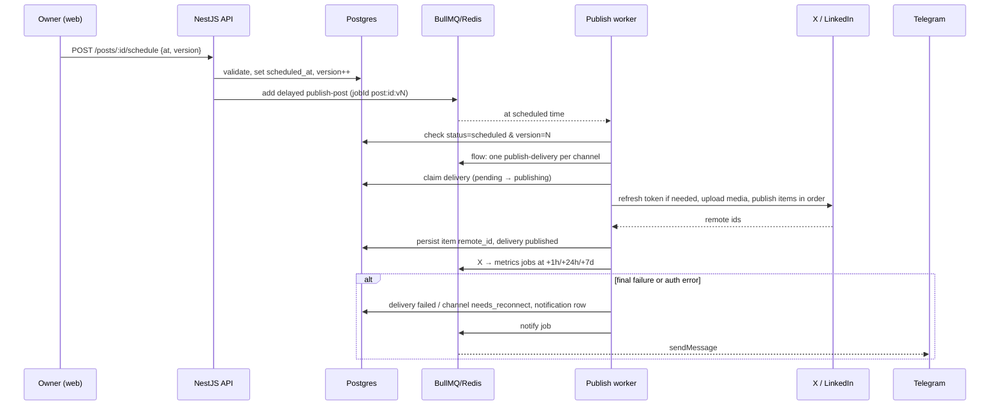

# Architecture

Overview of the omero-social-post design. The full source is the [technical spec](../../AiBuild/mvp/core-publishing/WIP/technical-spec.md). Some parts are still in progress according to the [plan](../../AiBuild/mvp/core-publishing/WIP/plan.md). Versión en español: [architecture.md](../es/architecture.md).

## Runtime topology

Copied from the technical spec:

```text
             Tailscale (HTTPS on *.ts.net, nothing public)
                              │
                       ┌──────▼──────┐
                       │  web (Next) │  /*        (UI)
                       │             │  /api/* ──► rewrite to api:4000 (same origin → first-party cookie)
                       └──────┬──────┘
                       ┌──────▼──────────────────────────┐
                       │ api (NestJS)                    │
                       │  HTTP controllers               │
                       │  BullMQ workers (same process)  │
                       └───┬───────────────────┬─────────┘
                    ┌──────▼─────┐       ┌─────▼─────┐      ┌───────────────┐
                    │ PostgreSQL │       │  Redis 8  │      │ media volume  │
                    │ (truth)    │       │ (BullMQ)  │      │ (local disk)  │
                    └────────────┘       └───────────┘      └───────────────┘
```

- **Workers run inside the API process.** `WORKERS_ENABLED=true` turns them on. They can move to their own container later without code changes.
- **Same origin.** `web` rewrites `/api/*` to the API, so the session cookie is first-party and no CORS setup is needed.
- **Exposure.** Only `web` publishes a port, and only on `127.0.0.1`. Tailscale serves HTTPS to it. Postgres, Redis and the API stay on the internal Docker network.

## Modules

Monorepo (pnpm workspaces + Turborepo):

| Package               | Contents                                                                                                                     |
| --------------------- | ---------------------------------------------------------------------------------------------------------------------------- |
| `apps/api`            | NestJS API and scheduler.                                                                                                    |
| `apps/web`            | Next.js UI (App Router).                                                                                                     |
| `packages/shared`     | zod schemas, per-network limits, the X character counter and the thread splitter. Shared by the composer and API validation. |
| `packages/api-client` | Typed client generated from OpenAPI.                                                                                         |
| `packages/config`     | TypeScript, ESLint and Prettier presets.                                                                                     |
| `infra/`              | Docker Compose, server bootstrap and backups.                                                                                |

API modules (`apps/api/src`), per the technical spec:

| Module          | Responsibility                                                      | Status                      |
| --------------- | ------------------------------------------------------------------- | --------------------------- |
| `auth`          | Owner setup, login, sessions and the global guard.                  | In the code                 |
| `providers`     | Network adapters, registry, OAuth state and PKCE, `GET /providers`. | In the code                 |
| `channels`      | OAuth connection, encrypted tokens and per-channel refresh.         | In progress (T020)          |
| `posts`         | Drafts, validation and versions.                                    | In the code                 |
| `scheduling`    | Post scheduling and per-channel deliveries.                         | In progress (T023 and T024) |
| `media`         | Image upload, sharp normalization and sha256 deduplication.         | In the code                 |
| `notifications` | In-app and Telegram alerts.                                         | In the code                 |
| `metrics`       | X metrics at +1 h, +24 h and +7 d.                                  | In progress (T026)          |
| `settings`      | Settings and weekly queue slots.                                    | In the code                 |
| `health`        | `GET /health`.                                                      | In the code                 |

Each network is an adapter behind the `SocialProvider` interface ([`apps/api/src/providers/provider.types.ts`](../../apps/api/src/providers/provider.types.ts)). Adding a network means adding an adapter without touching the domain modules. See [adding a provider](adding-a-provider.md).

## Postgres is the source of truth, BullMQ executes

- **Postgres holds the state:** posts, versions, deliveries, channels and encrypted tokens. Redis only holds BullMQ jobs.
- **Every job re-reads the database before acting.** A stale job (the post version changed, or the status is no longer `scheduled`) exits without doing anything.
- **If Redis loses data,** the reconciler re-enqueues scheduled posts that have no job. Posts and their deliveries remain in Postgres.

Queues (per the technical spec):

| Queue         | Job                  | What it does                                                          |
| ------------- | -------------------- | --------------------------------------------------------------------- |
| `publish`     | `publish-post`       | Parent, delayed until `scheduled_at`. Creates one child per delivery. |
| `publish`     | `publish-delivery`   | Child, one delivery per channel. Publishes the items.                 |
| `metrics`     | `fetch-metrics`      | X metrics at +1 h, +24 h and +7 d after publishing.                   |
| `maintenance` | `reconcile`          | Repeats every 5 min and runs on boot.                                 |
| `maintenance` | `token-expiry-check` | Repeats once a day.                                                   |
| `notify`      | `telegram`           | Sends the Telegram message.                                           |

Redis is configured with `maxmemory 128mb`, `maxmemory-policy noeviction` (required by BullMQ) and `appendonly yes`, so delayed jobs survive restarts.

## How publishing works

1. **Schedule.** `POST /posts/:id/schedule` validates the post, bumps `version` and enqueues a delayed `publish-post` with `jobId = post:{id}:v{N}`. Rescheduling removes the previous job. _(to confirm: the endpoint arrives with T023; today the code only has `POST /posts` and `PUT /posts/:id`)_
2. **Trigger.** When the time arrives, the parent job creates one `publish-delivery` per channel (BullMQ Flow).
3. **Claim.** The worker claims the delivery with a conditional `UPDATE` (`pending` or `failed` becomes `publishing`). If no row comes back, the job exits, so nothing is published twice.
4. **Token.** If the access token expires within 5 minutes, it is refreshed. A Redis lock per channel serializes refreshes, because X rotates refresh tokens and two concurrent refreshes would invalidate one.
5. **Publish.** Media is uploaded and items are published in order. Each item's `remote_id` is saved right after it is published. In an X thread, each item replies to the previous one.
6. **Finish.** The delivery status is updated and, from its deliveries, the post status. For X, metrics jobs are enqueued.

Technical flow, copied from the technical spec:



## Retries

- **Transient errors** (network, timeout, 429 and 5xx) are retryable. Per the spec, `publish-delivery` makes 3 attempts with exponential backoff from a 2 min base (≈ 2 + 4 + 8 min). _(to confirm when T024 is implemented)_
- **Auth errors** (rejected token) mark the channel `needs_reconnect` and are not retried. **Permanent errors** (rejected content, duplicates, exhausted credits) fail the delivery without retry. Both create a notification.
- **Manual or automatic retry** resumes from the first unpublished item, so items already live are not posted again.
- **Stuck deliveries** that stay in `publishing` for more than 20 minutes are marked `failed` with cause `interrupted`. They are not retried automatically, because the post might already be live. The owner checks the network.
- **Telegram notifications** make 5 attempts with exponential backoff from a 30 s base. A Telegram outage does not block publishing.

In the code, retries are opt-in per job: `DEFAULT_JOB_OPTIONS` only cleans up old jobs, and each job declares its own `attempts`. Network and API errors are classified with the classes in [`provider-errors.ts`](../../apps/api/src/providers/provider-errors.ts): `RetryableProviderError`, `ReauthRequired` and `PermanentProviderError`.

## See also

- [Configuration](configuration.md): every environment variable.
- [Adding a provider](adding-a-provider.md): implementing `SocialProvider`.
- [Self-hosting guide](self-hosting.md): from zero to a connected channel.
- Technical spec: [`AiBuild/mvp/core-publishing/WIP/technical-spec.md`](../../AiBuild/mvp/core-publishing/WIP/technical-spec.md).
