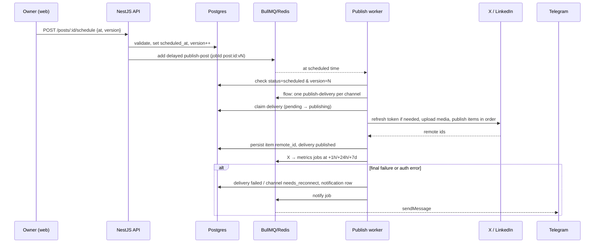

# Arquitectura

Resumen del diseño de omero-social-post. La fuente completa es la [spec técnica](../../AiBuild/mvp/core-publishing/WIP/technical-spec.md). Algunas piezas siguen en construcción según el [plan](../../AiBuild/mvp/core-publishing/WIP/plan.md). Versión en inglés: [architecture.md](../en/architecture.md).

## Topología en runtime

Copiada de la spec técnica:

```text
             Tailscale (HTTPS on *.ts.net, nothing public)
                              │
                       ┌──────▼──────┐
                       │  web (Next) │  /*        (UI)
                       │             │  /api/* ──► rewrite to api:4000 (same origin → first-party cookie)
                       └──────┬──────┘
                       ┌──────▼──────────────────────────┐
                       │ api (NestJS)                    │
                       │  HTTP controllers               │
                       │  BullMQ workers (same process)  │
                       └───┬───────────────────┬─────────┘
                    ┌──────▼─────┐       ┌─────▼─────┐      ┌───────────────┐
                    │ PostgreSQL │       │  Redis 8  │      │ media volume  │
                    │ (truth)    │       │ (BullMQ)  │      │ (local disk)  │
                    └────────────┘       └───────────┘      └───────────────┘
```

- **Workers en el proceso de la API:** se activan con `WORKERS_ENABLED=true`. Se pueden separar en su propio contenedor sin cambiar el código.
- **Mismo origen:** `web` reescribe `/api/*` hacia la API. Así la cookie de sesión es first-party y no hace falta CORS.
- **Exposición:** solo `web` publica un puerto, y únicamente en `127.0.0.1`. Tailscale sirve HTTPS hacia ese puerto. Postgres, Redis y la API quedan en la red interna de Docker.

## Módulos

Monorepo (pnpm workspaces + Turborepo):

| Paquete               | Qué contiene                                                                                                                  |
| --------------------- | ----------------------------------------------------------------------------------------------------------------------------- |
| `apps/api`            | API y scheduler en NestJS.                                                                                                    |
| `apps/web`            | Interfaz en Next.js (App Router).                                                                                             |
| `packages/shared`     | Schemas zod, límites por red, contador de caracteres de X y splitter de hilos. Lo usan el composer y la validación de la API. |
| `packages/api-client` | Cliente tipado generado desde OpenAPI.                                                                                        |
| `packages/config`     | Presets de TypeScript, ESLint y Prettier.                                                                                     |
| `infra/`              | Docker Compose, bootstrap del servidor y backups.                                                                             |

Módulos de la API (`apps/api/src`), según la spec técnica:

| Módulo          | Responsabilidad                                                         | Estado                        |
| --------------- | ----------------------------------------------------------------------- | ----------------------------- |
| `auth`          | Setup del dueño, login, sesiones y guard global.                        | En el código                  |
| `providers`     | Adaptadores por red, registro, state y PKCE de OAuth, `GET /providers`. | En el código                  |
| `channels`      | Conexión OAuth, tokens cifrados y refresh por canal.                    | En construcción (T020)        |
| `posts`         | Borradores, validación y versiones.                                     | En el código                  |
| `scheduling`    | Programación de posts y entregas por canal.                             | En construcción (T023 y T024) |
| `media`         | Subida de imágenes, normalización con sharp y deduplicación por sha256. | En el código                  |
| `notifications` | Avisos dentro de la app y por Telegram.                                 | En el código                  |
| `metrics`       | Métricas de X a +1 h, +24 h y +7 d.                                     | En construcción (T026)        |
| `settings`      | Ajustes y slots de la grilla semanal.                                   | En el código                  |
| `health`        | `GET /health`.                                                          | En el código                  |

Cada red es un adaptador detrás de la interfaz `SocialProvider` ([`apps/api/src/providers/provider.types.ts`](../../apps/api/src/providers/provider.types.ts)). Agregar una red es agregar un adaptador, sin tocar los módulos de dominio. Ver [cómo agregar una red](adding-a-provider.md).

## Postgres es la fuente de verdad, BullMQ ejecuta

- **Postgres guarda el estado:** posts, versiones, entregas, canales y tokens cifrados. Redis solo guarda los trabajos de BullMQ.
- **Cada job vuelve a leer la base antes de actuar.** Si un job quedó viejo (la versión del post cambió, o el estado ya no es `scheduled`), termina sin hacer nada.
- **Si Redis pierde datos,** el reconciliador vuelve a encolar los posts programados que quedaron sin job. Los posts y sus entregas siguen en Postgres.

Colas (según la spec técnica):

| Cola          | Job                  | Qué hace                                                         |
| ------------- | -------------------- | ---------------------------------------------------------------- |
| `publish`     | `publish-post`       | Padre, retrasado hasta `scheduled_at`. Crea un hijo por entrega. |
| `publish`     | `publish-delivery`   | Hijo, una entrega por canal. Publica los ítems.                  |
| `metrics`     | `fetch-metrics`      | Métricas de X a +1 h, +24 h y +7 d después de publicar.          |
| `maintenance` | `reconcile`          | Repetible cada 5 min y al arrancar.                              |
| `maintenance` | `token-expiry-check` | Repetible, una vez por día.                                      |
| `notify`      | `telegram`           | Envía el mensaje a Telegram.                                     |

Redis se configura con `maxmemory 128mb`, `maxmemory-policy noeviction` (BullMQ lo exige) y `appendonly yes`, para que los jobs retrasados sobrevivan a un reinicio.

## Cómo se publica

1. **Programar.** `POST /posts/:id/schedule` valida el post, sube `version` y encola un `publish-post` retrasado con `jobId = post:{id}:v{N}`. Al reprogramar, se borra el job anterior. _(por confirmar: el endpoint llega con T023; hoy el código solo tiene `POST /posts` y `PUT /posts/:id`)_
2. **Disparo.** Al llegar la hora, el job padre crea un `publish-delivery` por canal (BullMQ Flow).
3. **Reclamo.** El worker toma la entrega con un `UPDATE` condicional (`pending` o `failed` pasa a `publishing`). Si no vuelve ninguna fila, el job sale. Así no se publica dos veces.
4. **Token.** Si el access token vence en menos de 5 minutos, se renueva. Hay un lock de Redis por canal, porque X rota el refresh token y dos refresh simultáneos invalidarían uno.
5. **Publicación.** Se suben los medios y se publican los ítems en orden. El `remote_id` de cada ítem se guarda apenas se publica. En un hilo de X, cada ítem responde al anterior.
6. **Cierre.** Se actualiza el estado de la entrega y, a partir de sus entregas, el del post. Para X, se encolan las métricas.

Flujo técnico, copiado de la spec técnica:



## Reintentos

- **Errores transitorios** (red, timeout, 429 y 5xx) son reintentables. Según la spec, `publish-delivery` hace 3 intentos con backoff exponencial de base 2 min (≈ 2 + 4 + 8 min). _(por confirmar al implementar T024)_
- **Errores de auth** (token rechazado) marcan el canal como `needs_reconnect` y no se reintentan. **Errores permanentes** (contenido rechazado, duplicado, créditos agotados) fallan la entrega sin reintento. En ambos casos se crea una notificación.
- **Reintento manual o automático** retoma desde el primer ítem sin publicar. Así no se duplica lo que ya salió.
- **Entregas trabadas** en `publishing` por más de 20 minutos se marcan `failed` con causa `interrupted`. No se reintentan solas, porque el post podría estar ya publicado. El dueño verifica en la red.
- **Notificaciones de Telegram** tienen 5 intentos con backoff exponencial de base 30 s. Una caída de Telegram no frena la publicación.

En el código, los reintentos son opt-in por job: `DEFAULT_JOB_OPTIONS` solo limpia jobs viejos, y cada job declara sus `attempts`. Los errores de red y de la API se clasifican con las clases de [`provider-errors.ts`](../../apps/api/src/providers/provider-errors.ts): `RetryableProviderError`, `ReauthRequired` y `PermanentProviderError`.

## Relacionado

- [Configuración](configuration.md): todas las variables de entorno.
- [Cómo agregar una red](adding-a-provider.md): implementar `SocialProvider`.
- [Guía de self-hosting](self-hosting.md): de cero a un canal conectado.
- Spec técnica: [`AiBuild/mvp/core-publishing/WIP/technical-spec.md`](../../AiBuild/mvp/core-publishing/WIP/technical-spec.md).
